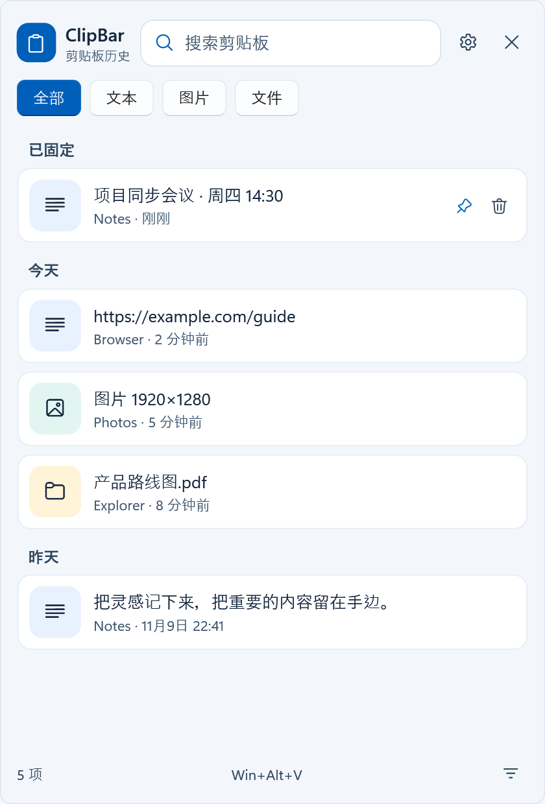
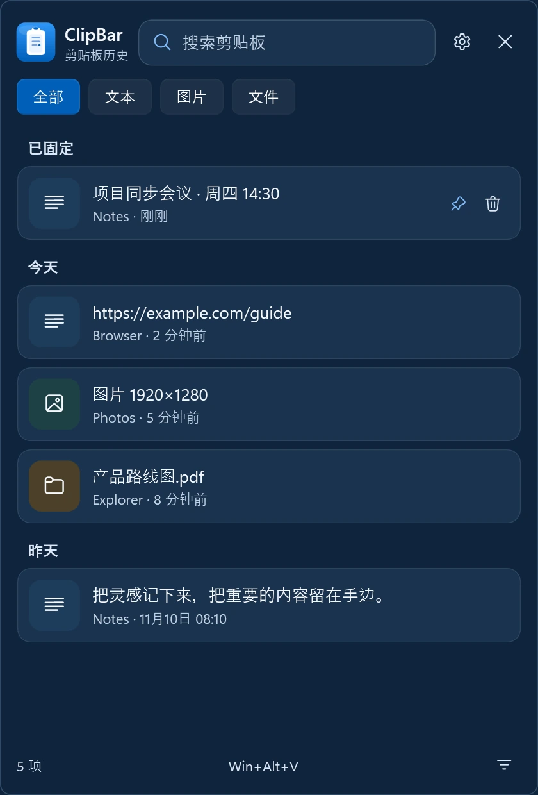
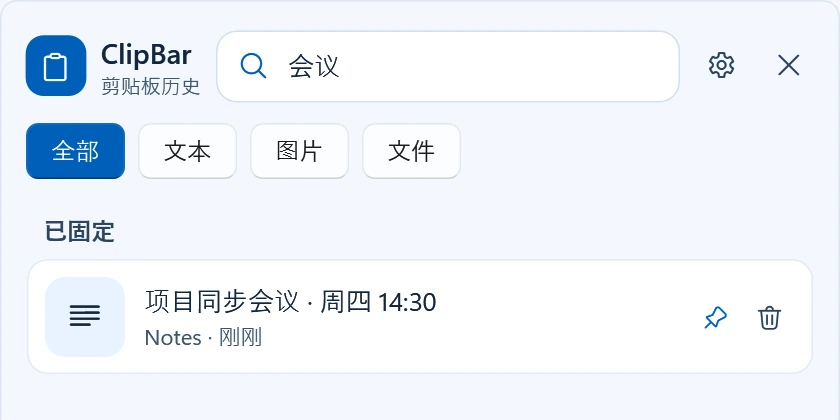
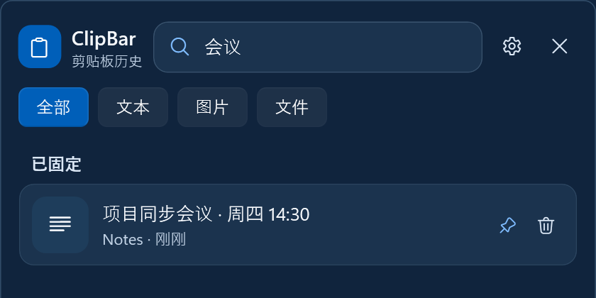
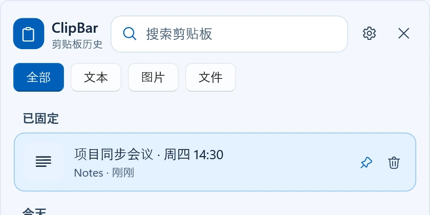
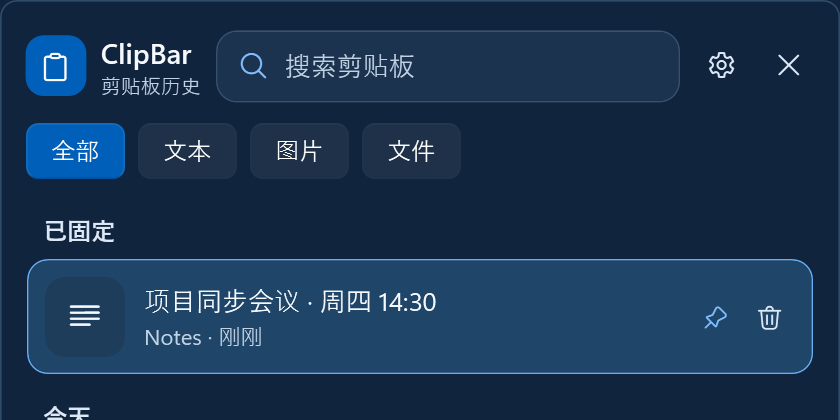
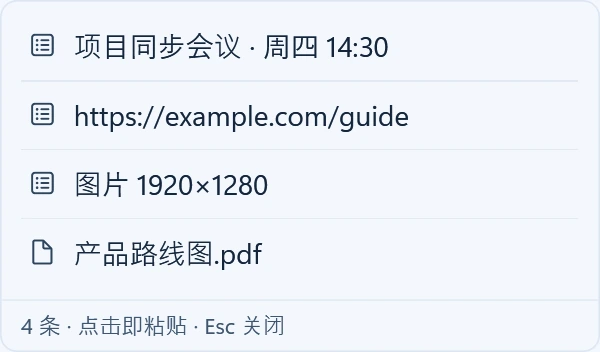
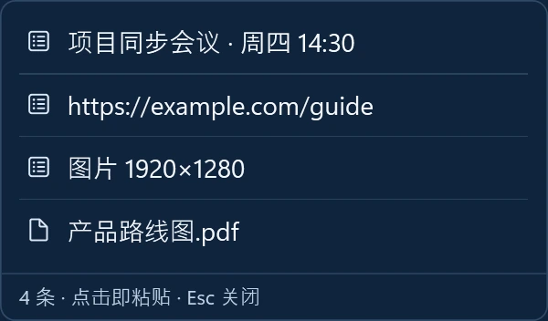

<p align="center">
  
</p>

<h1 align="center">ClipBar</h1>

<p align="center">
  复制过的内容，随时找回来。<br>
  Windows 本地剪贴板历史：搜索、固定、一键贴回，内容只留在你自己的电脑上。
</p>

<p align="center">
  <a href="https://github.com/xiaopeng66/ClipBar/releases/latest"><b>下载</b></a>
  &nbsp;·&nbsp; <a href="#功能">功能</a>
  &nbsp;·&nbsp; <a href="#界面预览">界面预览</a>
  &nbsp;·&nbsp; <a href="#安装">安装</a>
  &nbsp;·&nbsp; <a href="#常见用法">用法</a>
  &nbsp;·&nbsp; <a href="#从源码构建">构建</a>
</p>

<p align="center">
  
  &nbsp;&nbsp;
  
</p>

## 功能

### 记录与找回

- **四类内容**：文本、富文本 HTML、图片、文件列表，复制后自动进入历史。
- **内容去重**：按内容哈希判断，相同内容只留一条并置顶，不会越攒越乱。
- **固定不淘汰**：常用地址、模板、常发回复可固定，不参与自动清理；非固定条数上限可调。
- **时间分组**：列表按「已固定 / 今天 / 昨天 / 更早」分组，并标注来源应用与时间。
- **搜索高亮**：输入内容、文件名或来源应用即可缩小范围，命中片段直接高亮。
- **筛选**：类型筛选（全部 / 文本 / 图片 / 文件），来源应用筛选收在底部漏斗按钮里。

### 粘贴与整理

- **点一下贴回**：点击条目即复制并粘贴回原来的窗口；不需要时可改为只复制。
- **右键菜单**：粘贴为纯文本、图片另存为、用 Bing 搜索（可关）。
- **删除可撤销**：删除后底部出现 6 秒撤销提示，不弹窗打断操作。
- **连续粘贴**：可开启「粘贴后保持面板打开」，连续贴多条不用反复唤出。
- **托盘常驻**：托盘菜单可打开面板、暂停/恢复捕获、进入设置、清空历史、退出；单实例运行。

### 浮动操作条（可选）

- **长按唤出**：在任意文本框按住左键不动，指针旁出现浮动按钮。
- **拖选唤出**：拖选文字后松开鼠标，同样唤出（可在设置里关掉）。
- **悬停展开**：悬停按钮展开紧凑列表，点一行直接贴回刚才的窗口。
- **自动收起**：`Esc`、点面板外部、或鼠标移开一会儿都会自动收起。

### 外观与适配

- **三档主题**：浅色、深色、跟随系统，切换即时生效（含高对比度资源配对）。
- **图片预览三档**：大 / 中 / 小，切换后无需重启。
- **面板位置**：记住上次位置、鼠标所在显示器居中、或跟随指针，尺寸同样记忆。
- **高 DPI 清晰**：非整数缩放（125% / 150%）下文字与边框不发虚。

## 界面预览

<table>
  <tr>
    <td align="center"></td>
    <td align="center"></td>
  </tr>
  <tr>
    <td align="center"><sub>搜索：命中片段高亮，来源与时间一目了然</sub></td>
    <td align="center"><sub>同一界面在深色主题下</sub></td>
  </tr>
  <tr>
    <td align="center"></td>
    <td align="center"></td>
  </tr>
  <tr>
    <td align="center"><sub>固定项单独成组，不会被新历史挤走</sub></td>
    <td align="center"><sub>固定按钮与删除按钮固定在每一行右侧</sub></td>
  </tr>
  <tr>
    <td align="center"></td>
    <td align="center"></td>
  </tr>
  <tr>
    <td align="center"><sub>浮动条悬停展开的紧凑列表，点一行直接贴回</sub></td>
    <td align="center"><sub>窄窗口下自动省略过长文本</sub></td>
  </tr>
</table>

## 安装

从 [Releases](https://github.com/xiaopeng66/ClipBar/releases/latest) 下载，解压即用，无需安装：

| 文件 | 说明 |
| --- | --- |
| `ClipBar-win-x64.exe` | 标准版，自包含运行时，双击即用，无需预装任何东西 |
| `ClipBar-lite-win-x64.exe` | 轻量版，体积小得多，需要 [.NET 10 桌面运行时](https://dotnet.microsoft.com/download/dotnet/10.0) |
| `SHA256SUMS.txt` | 上面两个文件的 SHA-256 校验值 |

系统要求：Windows 10 / 11（x64）。

首次运行会在 `%LOCALAPPDATA%\ClipBar\` 建立数据目录：

```text
history.db     剪贴板历史（SQLite）
images\        图片内容
settings.json  设置
app.log        运行日志（超过 1 MB 轮转）
```

## 常见用法

1. 按 `Win+Alt+V` 唤出面板（默认热键，可在设置中改成自己顺手的组合）。
2. 复制任意文本、图片或文件，内容会自动进入历史。
3. 点击条目即贴回上一个窗口。

| 快捷键 | 作用 |
| --- | --- |
| `↑` `↓` | 在列表中移动选择 |
| `Enter` | 粘贴选中条目 |
| `Delete` | 删除选中条目 |
| `Ctrl+P` | 固定 / 取消固定 |
| `Ctrl+F` | 聚焦搜索框 |
| `Esc` | 关闭面板或浮动列表 |

设置里还可以调整：热键、历史条数、主题、图片预览档位、面板位置、点击是否自动粘贴、粘贴后是否保持面板、开机自启、是否记录图片/文件/HTML，以及**按进程名排除某些应用**（默认已排除常见密码管理器）。

## 从源码构建

需要 Windows、PowerShell 和 .NET 10 SDK。输出目录必须尚不存在，且与源码目录分离：

```powershell
cd ClipBar
.\build.cmd "..\clipbar-build" ".."
```

自包含版输出到 `..\clipbar-build\standard\ClipBar.exe`，轻量版输出到 `..\clipbar-build\lite\ClipBar.exe`，可直接上传的两种附件与校验文件在 `..\clipbar-build\release-assets\`。脚本不会覆盖运行中的程序或任何数据目录；也可以直接调用 `scripts/package.ps1`，用可选的 `PackageSource` 指定本地 NuGet 源做离线构建。

## 已知限制

- 仅支持 Windows x64；不做云同步，历史只在本机。
- 普通权限实例不会向提权窗口注入 `Ctrl+V`（系统限制），这种情况可在目标窗口手动粘贴。
- 历史可能包含敏感内容：请按需暂停捕获、配置排除应用，或用「清空全部历史」一次性清除。
- 剪贴板内容、设置文件与其中的路径字段一律按不可信输入处理，不会执行其中任何代码。

## 安全

发现安全问题请通过仓库的 **Security → Report a vulnerability** 私下报告，不要在公开 Issue 中贴出可利用细节。

## 贡献

欢迎提交 Issue 与改进建议。报告问题时请先移除真实剪贴板内容、账号信息和其他个人数据。

## 许可

MIT，见 [LICENSE](LICENSE)。
